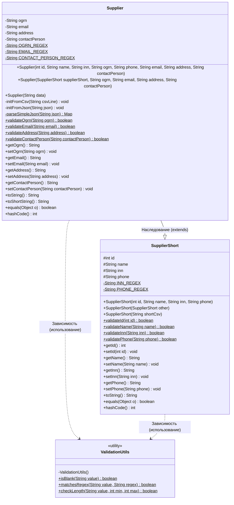

# Лабораторная работа №1. Пункт 10: Диаграмма классов UML

## Диаграмма классов предметной области (Вариант 8: Поставщик автозапчастей)

Ниже представлена полная диаграмма классов, отображающая структуру созданных классов, модификаторы доступа (`+` public, `-` private, `#` protected), типы данных, методы валидации, перегруженные конструкторы и связь наследования.

---

### 1. UML Диаграмма (Mermaid)

---

### 2. Описание элементов диаграммы

1. **`SupplierShort` (Базовый класс / Краткая модель):**
   * Хранит ключевые идентифицирующие атрибуты поставщика (`id`, `name`, `inn`, `phone`).
   * Поля объявлены с модификатором `#` (`protected`), что делает их доступными в классе-наследнике без нарушения инкапсуляции от внешнего мира.
   * Содержит статические методы валидации базовых полей.
   * Предоставляет перегруженные конструкторы: базовый, копирующий (из другого `SupplierShort` или `Supplier`) и из краткой строки CSV.

2. **`Supplier` (Класс-наследник / Полная модель):**
   * Наследует `id`, `name`, `inn`, `phone` и их геттеры/сеттеры/валидаторы от `SupplierShort`.
   * Добавляет приватные поля (`-` `private`): `ogrn`, `email`, `address`, `contactPerson`.
   * В конструкторах вызывает `super(...)` для бесконфликтной и единой инициализации базовой части.
   * Реализует нетривиальные перегрузки конструктора для парсинга полного CSV и JSON.
   * Переопределяет `toString()` (полный отчет), `toShortString()` (делегирование в суперкласс) и `equals`/`hashCode`.

3. **`ValidationUtils` (Утилитный класс):**
   * Имеет приватный конструктор, запрещающий создание объектов.
   * Содержит статические методы (`$`), устраняющие дублирование логики регулярных выражений и проверки строк в классах предметной области.
