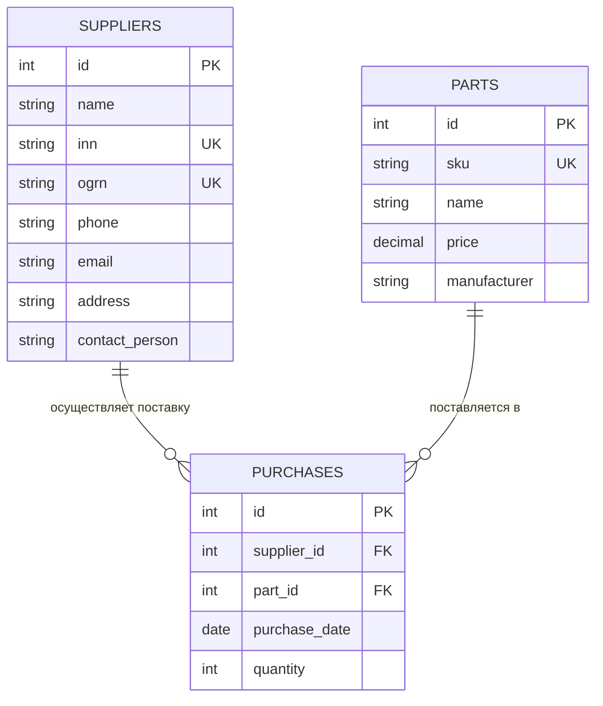

# Лабораторная работа №1. Пункт 1: ER-модель предметной области

## Вариант 8. Фирма по продаже запчастей

### 1. Описание предметной области
Фирма занимается продажей запасных частей для автомобилей и отслеживает финансовую сторону работы с поставщиками:
- Фирма взаимодействует с набором поставщиков (известны название, реквизиты, адрес, телефон, контактное лицо).
- У поставщиков приобретаются автозапчасти. Каждая деталь характеризуется наименованием, артикулом и постоянной ценой.
- Разные поставщики могут поставлять одинаковые детали (одинаковый артикул).
- Каждый факт покупки запчастей фиксируется в базе данных с обязательным указанием поставщика, закупаемой детали, даты покупки и количества.

---

### 2. Спецификация таблиц реляционной модели

#### Таблица 1: `suppliers` (Поставщики) — Независимая сущность
Хранит полную контактную и юридическую информацию о поставщиках автозапчастей.

| Поле | Тип данных | Описание | Ограничения |
| :--- | :--- | :--- | :--- |
| `id` | `INT` | Уникальный идентификатор | `PRIMARY KEY, AUTO_INCREMENT` |
| `name` | `VARCHAR(255)` | Название компании / юрлица | `NOT NULL` |
| `inn` | `VARCHAR(12)` | ИНН поставщика (10 или 12 цифр) | `NOT NULL, UNIQUE` |
| `ogrn` | `VARCHAR(15)` | ОГРН / ОГРНИП поставщика | `NOT NULL, UNIQUE` |
| `phone` | `VARCHAR(20)` | Контактный номер телефона | `NOT NULL` |
| `email` | `VARCHAR(100)` | Электронная почта | `NOT NULL` |
| `address` | `VARCHAR(255)` | Юридический/фактический адрес | `NOT NULL` |
| `contact_person` | `VARCHAR(150)` | ФИО контактного лица / менеджера | `NOT NULL` |

---

#### Таблица 2: `parts` (Автозапчасти) — Независимая сущность
Каталог автомобильных деталей, доступных к закупке.

| Поле | Тип данных | Описание | Ограничения |
| :--- | :--- | :--- | :--- |
| `id` | `INT` | Уникальный идентификатор детали | `PRIMARY KEY, AUTO_INCREMENT` |
| `sku` | `VARCHAR(50)` | Артикул детали (каталожный номер) | `NOT NULL, UNIQUE` |
| `name` | `VARCHAR(255)` | Наименование детали | `NOT NULL` |
| `price` | `DECIMAL(10, 2)` | Фиксированная цена за единицу | `NOT NULL, CHECK (price >= 0)` |
| `manufacturer` | `VARCHAR(100)` | Производитель / бренд детали | `NOT NULL` |

---

#### Таблица 3: `purchases` (Закупки у поставщиков) — Зависимая сущность (Транзакция)
Регистрирует факт совершения покупки партии автозапчастей у конкретного поставщика.

| Поле | Тип данных | Описание | Ограничения |
| :--- | :--- | :--- | :--- |
| `id` | `INT` | Идентификатор факта закупки | `PRIMARY KEY, AUTO_INCREMENT` |
| `supplier_id` | `INT` | Идентификатор поставщика | `FOREIGN KEY REFERENCES suppliers(id)` |
| `part_id` | `INT` | Идентификатор детали | `FOREIGN KEY REFERENCES parts(id)` |
| `purchase_date` | `DATE` | Дата совершения покупки | `NOT NULL` |
| `quantity` | `INT` | Количество приобретенных деталей | `NOT NULL, CHECK (quantity > 0)` |

---

### 3. Обоснование третьей нормальной формы (3НФ)

1. **Первая нормальная форма (1НФ):**
   - Все строки уникальны благодаря суррогатным первичным ключам `id`.
   - Значения всех атрибутов **атомарны** (неделимы): номера телефонов, адреса и имена хранятся в отдельных столбцах, отсутствуют повторяющиеся группы и составные массивы.

2. **Вторая нормальная форма (2НФ):**
   - Таблицы уже находятся в 1НФ.
   - Первичный ключ каждой таблицы является простым (состоит из одного поля `id`), следовательно, отсутствуют частичные зависимости неключевых атрибутов от составного ключа. Все неключевые поля функционально полно зависят от первичного ключа.

3. **Третья нормальная форма (3НФ):**
   - Таблицы уже находятся во 2НФ.
   - **Отсутствуют транзитивные зависимости**: ни один неключевой атрибут не зависит от другого неключевого атрибута ($X \rightarrow Y \rightarrow Z$).
   - Цена запчасти хранится в таблице `parts` и зависит только от `part_id`.
   - Реквизиты поставщика (ИНН, ОГРН, телефон) хранятся исключительно в таблице `suppliers` и не дублируются в таблице закупок `purchases`.

---

### 4. ER-диаграмма связей

