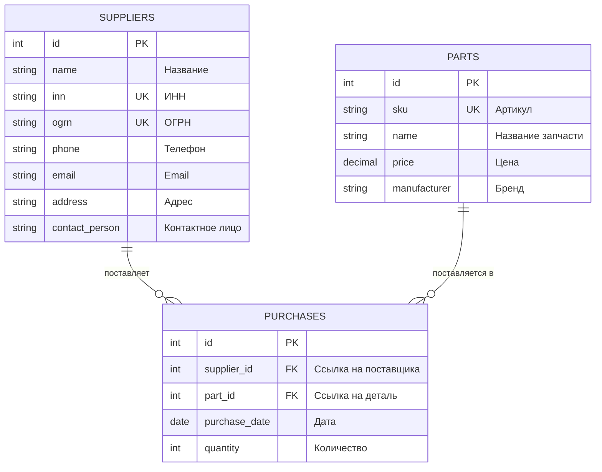

# Полное руководство по Лабораторной работе №1 (Для чайника ☕)

> **Курс:** Проектирование информационных систем (ПИС)  
> **Преподаватель:** Панеш Т.М., КубГУ ФКТиПМ  
> **Студент:** Дражин Никита (ПИ32)  
> **Вариант №8:** «Фирма по продаже автозапчастей»  
> **Язык:** Java

---

## 📌 Оглавление
1. [Простыми словами: в чем суть всей работы?](#1-простыми-словами-в-чем-суть-всей-работы)
2. [Шаг 1. База данных и 3НФ «на пальцах»](#2-шаг-1-база-данных-и-3нф-на-пальцах)
3. [Шаг 2. Почему мы выбрали Поставщика (Supplier)?](#3-шаг-2-почему-мы-выбрали-поставщика-supplier)
4. [Шаг 3. Что такое ООП и как устроены классы](#4-шаг-3-что-такое-ооп-и-как-устроены-классы)
5. [Построчный разбор кода каждого файла](#5-построчный-разбор-кода-каждого-файла)
   - [ValidationUtils.java](#51-validationutilsjava)
   - [SupplierShort.java](#52-suppliershortjava)
   - [Supplier.java](#53-supplierjava)
   - [Main.java](#54-mainjava)
6. [Шпаргалка к защите (ответы на 9 вопросов)](#6-шпаргалка-к-защите-ответы-на-9-вопросов)
7. [Как скомпилировать и запустить](#7-как-скомпилировать-и-запустить)

---

## 1. Простыми словами: в чем суть всей работы?

Представьте, что вы пришли работать программистом в фирму, торгующую автозапчастями. У фирмы есть 220 поставщиков.
Вам дали задачу: **написать надежную программу для учета этих поставщиков**.

Преподаватель в этой лабораторной проверяет две вещи:
1. **Умеете ли вы проектировать базы данных (БД)** без ошибок и дублирования данных (это называется 3-я нормальная форма, 3НФ).
2. **Понимаете ли вы объектно-ориентированное программирование (ООП) на Java**:
   * Данные должны быть защищены от взлома и глупых ошибок (инкапсуляция).
   * Нельзя создать поставщика с кривым телефоном или неправильным ИНН (валидация).
   * Нельзя писать один и тот же код дважды (наследование и утилиты).
   * Поставщика можно создавать по-разному: вручную, из CSV-строки или из JSON (перегрузка конструкторов).

В лабораторных ЛР2, ЛР3 и ЛР4 вы будете на этот же класс поставщика навешивать паттерны проектирования (фабрики, стратегии, адаптеры), поэтому в ЛР1 закладывается крепкий фундамент!

---

## 2. Шаг 1. База данных и 3НФ «на пальцах»

В вашем варианте три вещи:
1. **Поставщики (`suppliers`)** — фирмы, у которых мы покупаем детали.
2. **Детали (`parts`)** — каталог автозапчастей (свечи, тормозные колодки, фильтры).
3. **Закупки (`purchases`)** — чеки / накладные: кто, какую деталь, когда и сколько штук купил.



### Что такое 3НФ (Третья нормальная форма) простыми словами?
* **1НФ (Атомарность):** В одной ячейке таблицы хранится только ОДНО значение. Нельзя в одну строчку записать три телефона через запятую.
* **2НФ (Нет частичных зависимостей):** У каждой таблицы есть главный ключ `id`. Все остальные столбцы описывают именно этот `id`, а не что-то половинчатое.
* **3НФ (Нет транзитивных зависимостей):** Столбцы не зависят друг от друга. Например, в таблице покупок `purchases` мы храним только `supplier_id` (номер поставщика), а не пишем туда его телефон, адрес и имя. Потому что если поставщик сменит адрес, нам пришлось бы переписывать миллион записей в покупках. А так адрес лежит в одном месте — в таблице `suppliers`.

---

## 3. Шаг 2. Почему мы выбрали Поставщика (Supplier)?

Преподаватель требует: *«Выбрать независимую сущность с наибольшим числом полей»*.
* Покупка (`purchases`) — **зависимая**, потому что без поставщика и детали она существовать не может.
* Деталь (`parts`) — независимая, но полей мало (всего 5 штук).
* **Поставщик (`suppliers`)** — **независимая, и у нее больше всего полей (8 полей!)**:
  `id`, `name`, `inn`, `ogrn`, `phone`, `email`, `address`, `contact_person`.

Именно с Поставщиком вы будете работать все 4 лабораторные работы.

---

## 4. Шаг 3. Что такое ООП и как устроены классы

В реальной жизни есть **полная карточка поставщика** (со всеми реквизитами, адресами и менеджерами) и **краткая карточка** (для быстрого списка на экране: ID, Название, ИНН, Телефон).

Поэтому мы сделали **два класса**:
1. `SupplierShort` (Краткий поставщик) — хранит только 4 поля. Это **класс-родитель**.
2. `Supplier` (Полный поставщик) — добавляет еще 4 поля (ОГРН, email, адрес, менеджер). Это **класс-наследник**.

```text
               java.lang.Object (главный предок всей Java)
                      ▲
                      │ (наследование extends)
               SupplierShort (id, name, inn, phone)
                      ▲
                      │ (наследование extends)
               Supplier (+ ogrn, email, address, contactPerson)
```

Благодаря наследованию (`extends`):
* Полный `Supplier` **НЕ переписывает заново** поля ID, имя, ИНН и телефон. Он автоматически берет их у родителя `SupplierShort`.
* Нет дублирования кода!

---

## 5. Построчный разбор кода каждого файла

### 5.1. `ValidationUtils.java` (Утилитный класс проверок)

```java
package utils; // Файл лежит в папке utils
import java.util.regex.Pattern; // Подключаем инструмент для проверки регулярных выражений (шаблонов)

public final class ValidationUtils {
    // final означает: никто не может наследоваться от этого класса.

    private ValidationUtils() {}
    // Приватный конструктор: запрещает писать new ValidationUtils().
    // Зачем? Утилитные методы статические, создавать объект бессмысленно.

    public static boolean isBlank(String value) {
        // Проверяет: если строка null или состоит только из пробелов -> вернуть true
        return value == null || value.trim().isEmpty();
    }

    public static boolean matchesRegex(String value, String regex) {
        if (isBlank(value)) return false; // Пустая строка не пройдет проверку
        return Pattern.matches(regex, value.trim()); // Проверяет строку по шаблону
    }

    public static boolean checkLength(String value, int min, int max) {
        if (isBlank(value)) return false;
        int length = value.trim().length(); // Считаем длину без пробелов по краям
        return length >= min && length <= max; // Должно быть в границах [min, max]
    }
}
```

---

### 5.2. `SupplierShort.java` (Краткая версия / Родитель)

```java
package models;
import utils.ValidationUtils;
import java.util.Objects;

public class SupplierShort {
    // protected означает: поля закрыты от посторонних классов,
    // но класс-наследник Supplier видит их напрямую.
    protected int id;
    protected String name;
    protected String inn;
    protected String phone;

    // Константы шаблонов (regex):
    // ^\\d{10}$|^\\d{12}$ означает: ровно 10 цифр (для юрлиц) ИЛИ 12 цифр (для ИП)
    private static final String INN_REGEX = "^\\d{10}$|^\\d{12}$";
    private static final String PHONE_REGEX = "^(\\+7|8)[\\s\\-]?\\(?\\d{3}\\)?[\\s\\-]?\\d{3}[\\s\\-]?\\d{2}[\\s\\-]?\\d{2}$";

    // Основной конструктор:
    public SupplierShort(int id, String name, String inn, String phone) {
        setId(id);       // Записываем ID через сеттер с проверкой
        setName(name);   // Имя через сеттер
        setInn(inn);     // ИНН через сеттер
        setPhone(phone); // Телефон через сеттер
    }

    // Копирующий конструктор (принимает другой объект и копирует его данные):
    public SupplierShort(SupplierShort other) {
        if (other == null) throw new IllegalArgumentException("Объект не может быть null");
        setId(other.getId());
        setName(other.getName());
        setInn(other.getInn());
        setPhone(other.getPhone());
    }

    // Конструктор из строки CSV ("1;ООО Авто;7701234567;+79991234567"):
    public SupplierShort(String shortCsv) {
        if (shortCsv == null || shortCsv.trim().isEmpty()) {
            throw new IllegalArgumentException("Строка не может быть пустой");
        }
        String[] parts = shortCsv.split(";"); // Режем по точке с запятой
        if (parts.length != 4) {
            throw new IllegalArgumentException("Ожидалось 4 поля через ';'");
        }
        setId(Integer.parseInt(parts[0].trim())); // Переводим текст в число
        setName(parts[1].trim());
        setInn(parts[2].trim());
        setPhone(parts[3].trim());
    }

    // СТАТИЧЕСКИЕ МЕТОДЫ ВАЛИДАЦИИ:
    // static означает: можно вызвать SupplierShort.validateInn("7701234567") без создания объекта!
    public static boolean validateId(int id) { return id > 0; }
    public static boolean validateName(String name) { return ValidationUtils.checkLength(name, 2, 255); }
    public static boolean validateInn(String inn) { return ValidationUtils.matchesRegex(inn, INN_REGEX); }
    public static boolean validatePhone(String phone) { return ValidationUtils.matchesRegex(phone, PHONE_REGEX); }

    // ГЕТТЕРЫ И СЕТТЕРЫ (ИНКАПСУЛЯЦИЯ):
    public int getId() { return id; }
    public void setId(int id) {
        if (!validateId(id)) {
            // Если id <= 0, выбрасываем ошибку и прерываем создание объекта:
            throw new IllegalArgumentException("ID должен быть > 0");
        }
        this.id = id; // this.id — поле объекта, id — аргумент метода
    }

    public String getName() { return name; }
    public void setName(String name) {
        if (!validateName(name)) throw new IllegalArgumentException("Некорректное имя");
        this.name = name.trim();
    }

    public String getInn() { return inn; }
    public void setInn(String inn) {
        if (!validateInn(inn)) throw new IllegalArgumentException("Некорректный ИНН");
        this.inn = inn.trim();
    }

    public String getPhone() { return phone; }
    public void setPhone(String phone) {
        if (!validatePhone(phone)) throw new IllegalArgumentException("Некорректный телефон");
        this.phone = phone.trim();
    }

    // Метод toString(): возвращает краткую строку для вывода на экран
    @Override
    public String toString() {
        return String.format("SupplierShort [#%d]: %s | ИНН: %s | Тел: %s", id, name, inn, phone);
    }

    // Метод equals(): сравнивает двух поставщиков по ID и ИНН
    @Override
    public boolean equals(Object o) {
        if (this == o) return true; // Сравниваем объект с самим собой
        if (o == null || getClass() != o.getClass()) return false;
        SupplierShort that = (SupplierShort) o;
        return id == that.id && Objects.equals(inn, that.inn);
    }

    // Метод hashCode(): вычисляет хэш-код по тем же полям, что и equals!
    @Override
    public int hashCode() {
        return Objects.hash(id, inn);
    }
}
```

---

### 5.3. `Supplier.java` (Полная версия / Наследник)

```java
package models;
import utils.ValidationUtils;
import java.util.*;
import java.util.regex.*;

// extends SupplierShort означает: Supplier наследует всё от SupplierShort!
public class Supplier extends SupplierShort {

    // Объявляем только новые поля:
    private String ogrn;
    private String email;
    private String address;
    private String contactPerson;

    private static final String OGRN_REGEX = "^\\d{13}$|^\\d{15}$";
    private static final String EMAIL_REGEX = "^[A-Za-z0-9._%+-]+@[A-Za-z0-9.-]+\\.[A-Za-z]{2,6}$";
    private static final String CONTACT_PERSON_REGEX = "^[А-Яа-яЁёA-Za-z\\s\\-]{3,150}$";

    // Полный конструктор со всеми 8 полями:
    public Supplier(int id, String name, String inn, String ogrn,
                    String phone, String email, String address, String contactPerson) {
        // САМАЯ ГЛАВНАЯ СТРОЧКА:
        // super(...) вызывает конструктор родителя (SupplierShort).
        // Он инициализирует id, name, inn, phone.
        // Должен быть обязательно САМОЙ ПЕРВОЙ строкой!
        super(id, name, inn, phone);

        // Затем инициализируем свои поля:
        setOgrn(ogrn);
        setEmail(email);
        setAddress(address);
        setContactPerson(contactPerson);
    }

    // Конструктор из краткой версии:
    public Supplier(SupplierShort shortObj, String ogrn, String email, String address, String contactPerson) {
        this(shortObj.getId(), shortObj.getName(), shortObj.getInn(), ogrn,
             shortObj.getPhone(), email, address, contactPerson);
    }

    // Конструктор из строки (CSV или JSON):
    public Supplier(String data) {
        super(1, "Временный", "0000000000", "+79990000000"); // требование Java
        if (data == null || data.trim().isEmpty()) {
            throw new IllegalArgumentException("Строка не может быть пустой");
        }
        String trimmed = data.trim();
        if (trimmed.startsWith("{") && trimmed.endsWith("}")) {
            initFromJson(trimmed); // Парсим как JSON
        } else {
            initFromCsv(trimmed);  // Парсим как CSV
        }
    }

    // Парсер CSV:
    private void initFromCsv(String csvLine) {
        String[] parts = csvLine.split(";");
        if (parts.length != 8) throw new IllegalArgumentException("Ожидалось 8 полей через ';'");
        setId(Integer.parseInt(parts[0].trim()));
        setName(parts[1].trim());
        setInn(parts[2].trim());
        setOgrn(parts[3].trim());
        setPhone(parts[4].trim());
        setEmail(parts[5].trim());
        setAddress(parts[6].trim());
        setContactPerson(parts[7].trim());
    }

    // Парсер JSON без внешних библиотек:
    private void initFromJson(String json) {
        Map<String, String> map = parseSimpleJson(json);
        setId(Integer.parseInt(map.get("id")));
        setName(map.get("name"));
        setInn(map.get("inn"));
        setOgrn(map.get("ogrn"));
        setPhone(map.get("phone"));
        setEmail(map.get("email"));
        setAddress(map.get("address"));
        setContactPerson(map.get("contactPerson"));
    }

    // Дополнительные валидаторы для новых полей:
    public static boolean validateOgrn(String ogrn) { return ValidationUtils.matchesRegex(ogrn, OGRN_REGEX); }
    public static boolean validateEmail(String email) { return ValidationUtils.matchesRegex(email, EMAIL_REGEX); }
    public static boolean validateAddress(String address) { return ValidationUtils.checkLength(address, 5, 300); }
    public static boolean validateContactPerson(String cp) { return ValidationUtils.matchesRegex(cp, CONTACT_PERSON_REGEX); }

    // Сеттеры и геттеры для новых полей:
    public String getOgrn() { return ogrn; }
    public void setOgrn(String ogrn) {
        if (!validateOgrn(ogrn)) throw new IllegalArgumentException("Некорректный ОГРН");
        this.ogrn = ogrn.trim();
    }
    // (аналогично для email, address, contactPerson)

    // Полный красивый вывод:
    @Override
    public String toString() {
        return "=== Поставщик [ID: " + getId() + "] ===\n" +
               "  Название: " + getName() + "\n" +
               "  ИНН: " + getInn() + "\n" +
               "  ОГРН: " + ogrn + "\n" +
               "  Телефон: " + getPhone() + "\n" +
               "  Email: " + email + "\n" +
               "  Адрес: " + address + "\n" +
               "  Контактное лицо: " + contactPerson;
    }

    // Краткий вывод (вызывает метод родителя!):
    public String toShortString() {
        return super.toString();
    }
}
```

---

## 6. Шпаргалка к защите (ответы на 9 вопросов)

1. **Что такое класс и объект?**
   * *Класс* — это чертеж/шаблон (`Supplier`), где написано, какие поля и методы бывают у поставщика.
   * *Объект* — конкретный поставщик в памяти с реальными данными (`new Supplier(...)`).
2. **В чем суть инкапсуляции?**
   * Сокрытие внутренних данных от прямого вмешательства. Поля объявляются со словом `private` или `protected`. Доступ наружу дается только через геттеры (`getId()`) и сеттеры (`setId(...)`), внутри которых стоит проверка валидности.
3. **Что такое конструктор?**
   * Специальный метод, который вызывается при создании объекта (`new Supplier`). Его имя совпадает с именем класса, и у него нет возвращаемого типа. Нужен для правильного заполнения начальных данных.
4. **Механизм создания объекта?**
   * Загружается класс $\rightarrow$ выделяется память в куче (Heap) $\rightarrow$ поля заполняются нулями/null $\rightarrow$ вызываются конструкторы от предка к потомку (`super`) $\rightarrow$ возвращается ссылка на объект.
5. **В чем отличие статического метода от обычного?**
   * Обычный метод вызывается у конкретного объекта (`supplier.getName()`) и работает с его полями через `this`.
   * Статический метод (`static`) принадлежит всему классу и вызывается без создания объекта (`Supplier.validateInn("7701234567")`). Примеры: валидация данных перед созданием объекта и математические функции (`Math.sqrt`).
6. **Как устроен корень иерархии классов в Java?**
   * В Java все классы являются наследниками главного класса **`java.lang.Object`**. Наш `Supplier` наследует `SupplierShort`, а тот наследует `Object`.
7. **Что такое наследование и переопределение?**
   * Наследование (`extends`) позволяет забрать поля и методы базового класса.
   * Переопределение (`@Override`) позволяет заменить работу метода предка на свою собственную. Вызвать метод предка можно через `super.имяМетода()`.
8. **Как работают конструкторы при наследовании?**
   * Конструктор потомка **обязан** вызвать конструктор предка через `super(...)`. Этот вызов обязан быть **первой строкой**! Сначала создается предок, затем дополняется потомок.
9. **Какие методы есть у любого класса от `Object`?**
   * `equals()` — сравнение объектов на равенство по смыслу.
   * `hashCode()` — числовой код объекта для таблиц поиска.
   * `toString()` — превращение объекта в понятную строку текста.
   * `getClass()` — узнать точный тип объекта во время работы.
   * `clone()` — клонирование (копирование).
   * `wait()`, `notify()`, `notifyAll()` — синхронизация потоков.

---

## 7. Как скомпилировать и запустить

В терминале Windows:

```powershell
# Компиляция всех файлов
& "C:\Program Files\JetBrains\PyCharm 2026.2.3\jbr\bin\javac.exe" -encoding UTF-8 -d "Laba 1/out" "Laba 1/src/utils/ValidationUtils.java" "Laba 1/src/models/SupplierShort.java" "Laba 1/src/models/Supplier.java" "Laba 1/src/Main.java"

# Запуск программы
& "C:\Program Files\JetBrains\PyCharm 2026.2.3\jbr\bin\java.exe" "-Dfile.encoding=UTF-8" -cp "Laba 1/out" Main
```
